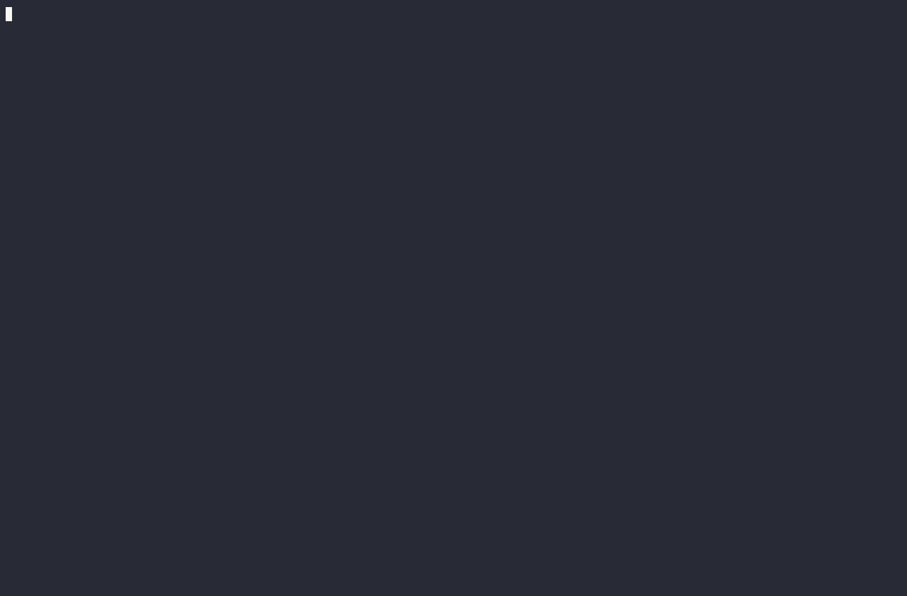

# Voltix

License: [MIT](LICENSE)

Voltix is a Linux edge controller and telemetry gateway for a *simulated*
battery energy storage site. A Go daemon polls a pymodbus SunSpec
inverter + site meter, applies a 1 Hz supervisory control loop under
authenticated dispatch leases with safe fallback, and durably buffers
telemetry in SQLite for at-least-once upload with receiver-side
deduplication.

## Architecture at a glance

```
                 field network                     upstream network
  POST /api/dispatch --> [ voltix ] -- Modbus TCP --> [ sim inverter :1502 ]
  GET  /api/status    (1 Hz loop,    -- Modbus TCP --> [ sim meter    :1503 ]
                       policy clamp,                  [ sim control   :1504 ]
                       SQLite store)
                              `-- HTTP batches ----> [ upstream-mock :8081 ]
```

- `internal/device` — bounded Modbus/SunSpec adapters (socket deadlines,
  no write replays, sentinel decode) driven by a frozen wire profile
  (`contracts/sunspec-profile.json` + golden fixtures).
- `internal/dispatch` — bearer-auth dispatch sessions: random boot
  session, strict revisions, dual monotonic+wall expiry (max 30 s).
- `internal/policy` + `internal/control` — single-owner 1 Hz loop:
  hard-interval clamp, slew limit from measured baseline, serialized
  fresh writes, bounded snapshot channel.
- `internal/store` + `internal/syncer` — WAL+FULL SQLite event store
  (two bounded tiers, never-reused sequence IDs, atomic eviction) and a
  one-in-flight uploader with jittered backoff + exact-ack pruning.
- `internal/upstream` — transactional receiver (test mock) with
  `(stream_id, seq_id)` dedup and commit-before-ack.
- `cmd/voltix`, `cmd/upstream-mock` — binaries; `deploy/` — Compose demo
  and systemd user-unit packaging; `sim/` — battery-site simulator.

## Development setup

Prerequisites verified on Linux x86_64 (2026-10-12):

- **Go 1.27.2** — install the official tarball to `~/.local/go` and add
  `~/.local/go/bin` to `PATH`:
  ```bash
  curl -sLO https://go.dev/dl/go1.27.2.linux-amd64.tar.gz
  tar -C ~/.local -xzf go1.27.2.linux-amd64.tar.gz
  ```
  (the Makefile auto-locates `~/.local/go/bin/go` when `go` is not on `PATH`)
- **uv** — manages the simulator's Python environment (CPython 3.13)
  under `sim/`.
- **Docker + Compose plugin** — for the isolated demo and fault harness
  (verified with Docker 29.7.2).
- **systemd --user** — for the native-service check (a running user
  manager; verified on systemd 259).

## Commands

```bash
make build         # bin/voltix + bin/upstream-mock
make test          # Go unit tests
make check         # gofmt + go vet
make sim-test      # simulator physics + wire tests (26 tests)
make integration   # real-process tests (sim + controller + store + receiver)
make demo          # isolated Compose site: bounded readiness, prints endpoints
make demo-down     # remove containers, networks AND volumes
make demo-watch    # three-pane live view via zellij (logs / sim / runner)
make native-test   # systemd --user service verification (11 checks, no root)
make fault-test    # fault scenarios A/B/C3/C4/D on the Compose stack (16 checks)
```

Tokens are environment-only: `VOLTIX_DISPATCH_TOKEN`,
`VOLTIX_TELEMETRY_TOKEN`. The demo uses documented local-only defaults.

Run the controller natively against the sim:

```bash
cd sim && uv run python -m voltix_sim &          # :1502 :1503 :1504
VOLTIX_DISPATCH_TOKEN=dev VOLTIX_TELEMETRY_TOKEN=dev \
  ./bin/voltix -config configs/example.yaml
```

See [deploy/README.md](deploy/README.md) for the Compose topology,
native unit install/remove, and the dispatch request schema, and
[docs/operations-runbook.md](docs/operations-runbook.md) for the full
operating procedure, fault playbook, and limitations.



`make demo-watch` opens the live three-pane layout (requires `zellij`);
the recordings — replayable `script` typescript, asciinema cast, and
this GIF — are documented in [evidence/demo/README.md](evidence/demo/README.md).

## Measured claims (dev host, 2026-10-12)

- Store commit throughput ≈ 4 151 events/s (241 µs/commit), RSS ≈ 15.4 MB.
- systemd restart after SIGKILL: new boot session in ≈ 2.7 s.
- Dispatch-expiry fallback starts ≈ expiry+0 s; output reaches 0 within
  the slew allowance. Sim watchdog trips 10 s after last accepted write,
  for both link loss and controller absence.
- Full evidence: `evidence/` per milestone + `make fault-test` /
  `native-test` re-runnable checks.

These are development-host measurements on a simulator, not production
or hardware guarantees. Known limitations (no ENOSPC/hardware-power-loss
proof, loopback-only demo, no netns-level fault injection) are listed in
the runbook and milestone findings.

## Project documentation

- [Learning guide: domain, architecture, and demo meaning](docs/learning-guide.md)
- [Documentation workflow](docs/project/documentation-guide.md)
- [Roadmap and milestone progress](docs/project/roadmap.md)
- [Backlog and next work](docs/project/backlog.md)
- [Architecture and design status](docs/project/architecture.md)
- [Operations runbook](docs/operations-runbook.md)
- [Blockers and open questions](docs/project/blockers.md)
- Behavioural contracts: [device profile](docs/project/features/device-profile.md), [control](docs/project/features/control.md), [telemetry](docs/project/features/telemetry.md), [verification](docs/project/features/verification.md)
- [Decision records](docs/project/decisions/)
- [Work journal](docs/project/journal/)
- [Agent tooling notes](docs/project/agent-tooling-notes.md) — known file-tool failure modes and mitigations
- [Initial discussions](docs/initial-discussion/) — background proposals, not the canonical implementation specification

Read [AGENTS.md](AGENTS.md) and the documentation workflow before meaningful project work.
