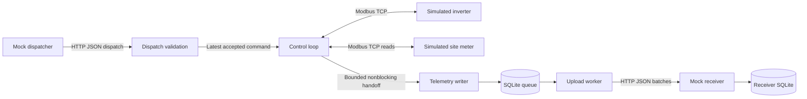

# Voltix architecture

Updated: 2026-10-12
Status: Selected implementation baseline under the user's planning request; not implemented or runtime-verified.

## Purpose and boundaries

One controller supervises one simulated battery inverter and a site power meter on Linux. A local upstream mock issues dispatch commands and receives telemetry. All components belong to one repository; all Go code uses one root module. The simulator is a separate Python process with pinned dependencies.

The controller is an application-layer service with a nominal 1 Hz loop. It does not replace inverter/BMS protection or provide hard real-time or grid-compliance guarantees. Decisions: [scope and delivery](decisions/002-scope-and-delivery.md), [failure and persistence policies](decisions/003-failure-and-persistence.md).

## Runtime flow



WAN failures are separated from field-device failures. Dispatch and telemetry use distinct ports/routes so tests can disable one without disabling the other. These are logical isolated test networks; no public cloud is needed.

## Stack

| Area | Selection | Verification gate |
| --- | --- | --- |
| Controller and upstream mock | Go; standard library HTTP/JSON and structured logging | VTX-003 pins a supported stable toolchain |
| Simulator | Python with pymodbus | VTX-003 pins Python/dependencies; VTX-004 proves API/protocol suitability |
| Field interface | Modbus TCP, explicit SunSpec simulator profile | VTX-004 pins upstream definitions and byte-level fixtures |
| Persistence | Embedded SQLite WAL, synchronous FULL | VTX-012 selects/pins a maintained Go driver and tests commit/recovery behaviour |
| Deployment | Linux native binary + systemd; Compose reproduction | VTX-016/017 verify these distinct environments |
| Verification | Go tests/race checks, Python simulator tests, integration and Linux fault harness | Each task owns relevant checks; final matrix in VTX-020 |

Do not use the proposal's old minimum Go version as a current pin. Runtime/library versions are chosen from supported releases at bootstrap with compatibility evidence. No Redis, broker, custom WAL, framework, or orchestration platform is needed.

## Intended repository layout

Create files when their task needs them; this is not a requirement to generate empty packages.

```text
cmd/voltix/main.go              Entry point, wiring, shutdown
internal/config/               Validated configuration
internal/dispatch/             HTTP validation, session/lease handling
internal/driver/               Narrow device interfaces and Modbus/SunSpec adapter
internal/engine/               Pure control policy and loop orchestration
internal/queue/                SQLite event persistence and retention
internal/syncer/               Bounded HTTP uploader and retry
sim/inverter/                  Python site simulator and tests
sim/cloud/                     Go dispatcher/receiver entry point (root Go module)
configs/                       Example configuration without secrets
contracts/                     Checked device register manifest and golden fixtures
tests/integration/            Cross-process acceptance tests
deploy/                        Compose definition and systemd unit
scripts/                       Test environment and demo orchestration
docs/project/                 Canonical specifications and evidence
go.mod, go.sum, Makefile        Reproducible commands and Go dependency ownership
```

Unit tests live beside their code. Scripts arrange test environments and cleanup; prefer test code for substantive assertions. Interfaces live near their consumers and stay small: read inverter, read meter, set absolute power target. Do not introduce generic plugin registries or a public SDK.

## Concurrency and control ownership

One loop owns operating state and the last acknowledged setpoint. The HTTP handler validates a candidate and replaces a bounded latest-command slot; it never writes a device. Drivers use one serialised connection owner per endpoint. Independent inverter/meter endpoints may be polled concurrently, but reads/writes on a shared client are not assumed concurrency-safe.

A cycle reads fresh inputs, validates the current command, computes a constrained target, attempts a bounded write, and emits a snapshot. A write acknowledgement means the device accepted the command; measured output remains a separate value. Timeout after a write leaves application state uncertain; reread on recovery and never retry a superseded target blindly.

Read and write socket deadlines must be enforced by the actual driver. Context cancellation is orchestration, not proof of interrupted network I/O. Initial engineering budgets are in the [control contract](features/control.md); measure them before claiming deadline adherence. Go's network connection API documents read/write deadlines: [net.Conn](https://pkg.go.dev/net#Conn).

Queue persistence and upload run outside the loop. A bounded handoff makes overflow explicit. HTTP batches have size/time limits and no database transaction remains open while waiting for a network response.

## Contracts

- [Device profile](features/device-profile.md): discovery, model selection, sign/units, simulation and watchdog semantics.
- [Control](features/control.md): command lifecycle, freshness, operating states, constraints and timing.
- [Telemetry](features/telemetry.md): identities, durable boundary, retention, acknowledgements and failure handling.
- [Verification](features/verification.md): reproducible acceptance scenarios and evidence boundaries.

## Configuration and observability

Configuration names the controller, device endpoints/unit IDs, SunSpec base address, physical/demo limits, timing budgets, storage directory/retention, and upstream endpoints. Reject missing or inconsistent required settings before starting active control. Example defaults are simulation choices, not real-site recommendations.

Use structured logs with state/reason, command revision, target and measured power, input freshness, driver failures, loop durations, queue occupancy, retry counts and loss counters. Avoid per-tick unbounded fault events; emit transitions and periodic summaries. Never log bearer tokens or entire untrusted requests.

Local HTTP management exposes process liveness and a redacted status snapshot including boot session, operating state, measurements with ages, accepted command, queue state and fault reasons. Bind to loopback by default; container bindings are limited to the private demo network. Bearer tokens come from environment/ignored configuration. This is a local authenticated demo, not a public Internet deployment. A degraded controller can be alive; health endpoints must not erase that distinction.

## Deployment and lifecycle

The convenient demo runs containers; native verification runs the Go binary under systemd and keeps simulated devices/backend in test processes or containers. Use an unprivileged controller user and a dedicated writable state directory. Port 1502 is the simulator default so low-port privileges are unnecessary. Only the isolated fault harness requires network-administration capabilities.

Graceful shutdown stops accepting commands, attempts a bounded fallback request, and closes workers/storage within a budget. No shutdown hook is relied upon for correctness after kill -9: the independent simulated inverter watchdog remains responsible for that case.

A separate runbook will document service install/removal, startup, logs, state/reset policy and cleanup once tested. No automatic installation into the user's host or changes to global network rules are part of planning.

## Current state and remaining gates

Only documentation exists. Git status in this environment reports no usable Git repository; no initialisation, module creation, dependencies, tests, or service installation occurred during planning. [Open questions](blockers.md) identify protocol, driver, and native-environment verification gates without describing them as failed attempts.
